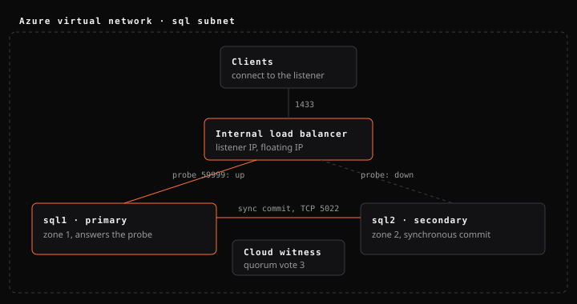

<p></p>

# azure-sql-ag-runbook

[](https://github.com/TheSansySasy/azure-sql-ag-runbook/actions/workflows/ci.yml)


A two-node SQL Server Always On availability group on Azure: the infrastructure as Bicep, the build and failover procedures, the scripts I would want on call, and a troubleshooting guide for the Kerberos failure that is easy to misdiagnose.

> **A clean-room reference.** It captures how I build and run this kind of cluster, written from scratch for this repository. Nothing in it comes from a client environment. The story behind the troubleshooting guide is at [sansysasy.com](https://sansysasy.com/#work/sql-always-on-azure).



## Contents

| Path | What it is |
|---|---|
| [`infra/main.bicep`](infra/main.bicep) | Two SQL Server 2022 VMs in separate availability zones, the network, an internal Standard load balancer for the listener (floating IP, probe port 59999), and a storage account for the cloud witness |
| [`docs/build.md`](docs/build.md) | Domain join, cluster, quorum, Always On, and wiring the listener's IP resource to the load balancer probe |
| [`docs/failover.md`](docs/failover.md) | Planned, automatic and forced failover, and what to check before and after |
| [`docs/kerberos-cau.md`](docs/kerberos-cau.md) | `KRB_AP_ERR_MODIFIED`: what it means, the search in order, and the offline Cluster-Aware Updating role behind it |
| [`docs/monitoring.md`](docs/monitoring.md) | What to watch and why, including every cluster resource's state |
| [`scripts/New-AdForest.ps1`](scripts/New-AdForest.ps1) | Promotes a server to the first domain controller of a new forest, for when no domain exists yet; supports `-WhatIf` |
| [`scripts/Watch-DiskThreshold.ps1`](scripts/Watch-DiskThreshold.ps1) | Warn and critical free-space thresholds per volume, a webhook, and an exit code any agent can read |
| [`scripts/Invoke-CpuFailover.ps1`](scripts/Invoke-CpuFailover.ps1) | Fails over on sustained CPU, only to a synchronized secondary, with a cooldown; supports `-WhatIf` |
| [`scripts/Test-KerberosHealth.ps1`](scripts/Test-KerberosHealth.ps1) | Duplicate SPNs, the listener SPN, the machine account, and cluster resource states, as one table |

## Deploy

```bash
az deployment group create --resource-group <rg> --template-file infra/main.bicep \
  --parameters adminUsername=<admin> adminPassword=<password>
```

Then follow [`docs/build.md`](docs/build.md). The template leaves public RDP closed; administer through Azure Bastion or a VPN.

This is the single-subnet design, where an internal load balancer carries the listener. Microsoft also supports a multi-subnet design, with each replica in its own subnet, which needs no load balancer. Choose it for new builds when the network allows.

## Checks

```bash
az bicep build --file infra/main.bicep
az bicep lint --file infra/main.bicep
```

```powershell
Invoke-Pester ./tests    # Pester 5; the scripts' decision logic, no cluster needed
```

---

[Sanskar Rai](https://sansysasy.com) · [@SansySasy](https://github.com/TheSansySasy) · MIT licence
